# SlopeCraft Tutorial

This document will explain in detail how to use SlopeCraft to create 3D, flat and file-only map arts.

To eliminate ambiguity, here is the meaning of a few terms:

| Term | Meaning |
| :--: | :------ |
| Map | The item in Minecraft whose id is `minecraft:filled_map` |
| Save | A Minecraft game save |
| Map art | The image displayed in a map item |
| Map data file | The nbt binary file that stores map data, named like `map_<i>.dat` |

!!! tip "tip"
    You can find the option to switch languages in the **Language** drop-down menu of the menu bar.

## Step 0. Image preprocessing

First, prepare the original image you want to turn into a map art. The image used here is [the one drawn by Lancet_Corgi](https://t.bilibili.com/544583492149793294), thanks to Daoge for the permission.

Use Photoshop or any other software that can edit images to **scale its width and height to an integer multiple of 128 pixels**.

Here I scaled the image to 256×256 pixels, which happens to be the size of a 2×2 map.


(Resizing **is not mandatory**, and SlopeCraft does not include a feature to scale images either, but I highly recommend doing it)

Save this image.

## Step 1. Map art configuration

Double click SlopeCraft.exe to start it, and you will see the following window.

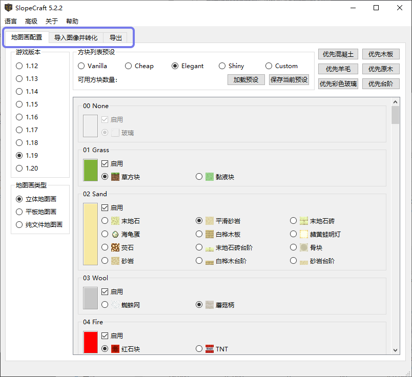

The three page tabs at the top represent the three steps of creating a map art:

1. Map art configuration
2. Import images and convert
3. Export

Outside this software there is a fourth step: importing the files into the game.

You should now be on the map art configuration page. On this page you need to finish three small steps, each explained below.

### 1.1 Choose the game version

You need to set the game version the map art corresponds to.

Versions from 1.12 to 26.3 are supported at the moment. I will keep following newer versions, but will not support old versions before 1.12.

Note that 1.12~1.15 have no difference in the "image quality" of map arts: a flat map art has 51 colors and a 3D map art has 153 colors. 1.16 added 7 base colors for the nether tree, so a flat map art can use 58 colors and a 3D map art can use 174 colors. 1.17 added the colors of deepslate, raw iron block and glow lichen, so a flat map art can use 61 colors and a 3D map art can use 183 colors.

> *Rant: why does Mojang give the nether tree so many colors? Wouldn't more skin colors be better?*

### 1.2 Choose the type of map art

Here you need to choose **the type of map art**:

- **3D map art**: achieves **the richest colors** and **the finest image quality**, at the cost of being hard to build.
- **Flat map art**: the traditional type of map art, with **ordinary image quality** and a relatively simple build.
- **File-only map art**: **the best image quality** a vanilla map art can reach. It cannot be built, and usually can only be obtained with commands. If you do not need the map art to exist in the game as blocks, but only to be displayed on a map and to be able to hang in an item frame, choose this option.

    Note that this kind of file-only map art requires at least replacing files in your save, and may also require commands. It is generally only usable in single-player games, or if you are a server administrator.

Here I chose 3D map art.

### 1.3 Set the block list

The block list is in fact the "**material list**", or "**palette**", of a map art. **It determines which colors the palette of the map art contains, and which block each color corresponds to.**

This page is relatively complex, so I will introduce every part in turn. **(In fact, you usually do not need to adjust the block list yourself at all)**

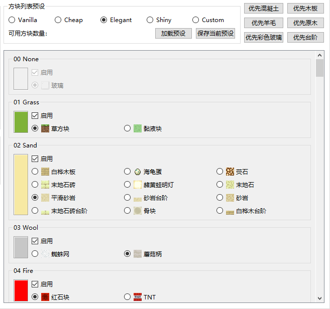

The slider area shows every base color. In the **Enable** box you can check **whether SlopeCraft is allowed to use this color**. By default every available base color is checked except **water** (some colors are not available in lower versions).

Below the enable box are **the blocks corresponding to each color**. In the palette every color can only use one block.

- You may think that many blocks in the figure have different colors, but note that **they are exactly the same in the "eyes of the map"**; the only basis for choosing is whether the block is easy to mass-produce.
- Some base colors only have one usable block, and the palette cannot have holes, so this option cannot be changed — like the glass or *emerald block (not shown in the figure)* in the figure, it must be selected.

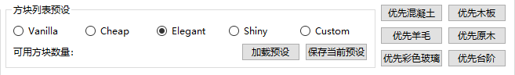

There are four block list presets to choose from at the top:

- Vanilla is "**the original flavor**", trying to use the "original block" of each color. It suits creative mode better and is not suitable for survival builds.
- Cheap tries hard to pick **the cheapest blocks**, making sure every block can be mass-produced. It suits the early stage of survival.
- Elegant tries to pick "**the most elegant blocks**" while still being usable in survival, for example blocks that endermen cannot steal away, that look good and are not too hard to mass-produce. This is the default option.
- Shiny **is made for shaders**: it picks glowing blocks as much as possible, striving to be gorgeous enough with shaders.
- Custom means you are using a **custom** block list.

**A block list preset shows how many colors this map art can use.** If you disable some base colors, this number decreases a bit. **So the richer the palette and the larger the map art, the better the image quality.**

The **prefer concrete** and other buttons in the upper right corner are there for bulk operations; their meaning is rather obvious and needs no explanation.

#### Saving and loading presets

You can export the current block list so that you can load it next time. The file is stored in json and its suffix is `.sc_preset_json`.

______________________________________________________________________________________________________________

When you are done with these settings, click the **Import images and convert** tab at the top to go to the next step.

## Step 2. Import images and convert

On this page you need to finish two small steps: import images, and convert them into map arts.

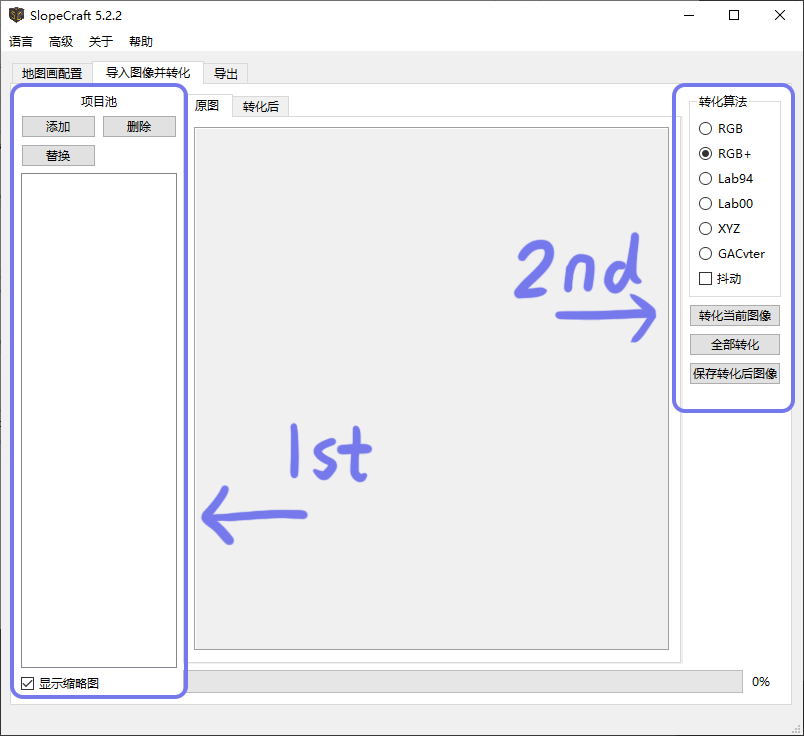

### 2.1 Import images

??? question "What is the 'project pool'?"  
    SlopeCraft 5.1 introduced a new feature: the "**project pool**".  
    Every image you import is created as a project by the program, and the subsequent conversion operations add data to the project.

    The project pool works like a system file manager: select a single image to preview it or to perform the corresponding operations.

    Simply put, you can now do batch operations conveniently!  
    **Note: one batch of images can only use one conversion algorithm; images with very different styles or colors should be processed in separate batches!**

In the project pool, click **Add** to import **one or more** preprocessed images.

If your original image has transparent or semi-transparent pixels, a window to set the **transparent pixel handling strategy** pops up automatically. The details are as follows:

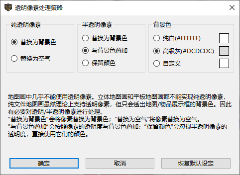

The transparent pixel handling strategy handles fully transparent pixels (alpha=0) and semi-transparent pixels (alpha>0) in different ways. A fully transparent pixel is either replaced with the background color or set to air; a semi-transparent pixel can be replaced with the background color, blended over the background color, or have its transparency ignored and be treated directly as an opaque pixel. The background color can also be set: the default is the light gray of tiled snow blocks, and you can also choose pure white or any custom color.

**Note: transparent pixels are processed when importing. If you are not satisfied with the result, delete the project from the project pool and import the image again.**

When the import finishes, the corresponding project appears in the project pool on the left; select a project to preview it.

### 2.2 Convert images

With all the preparation above done, it is time for the main course: converting images into map arts.

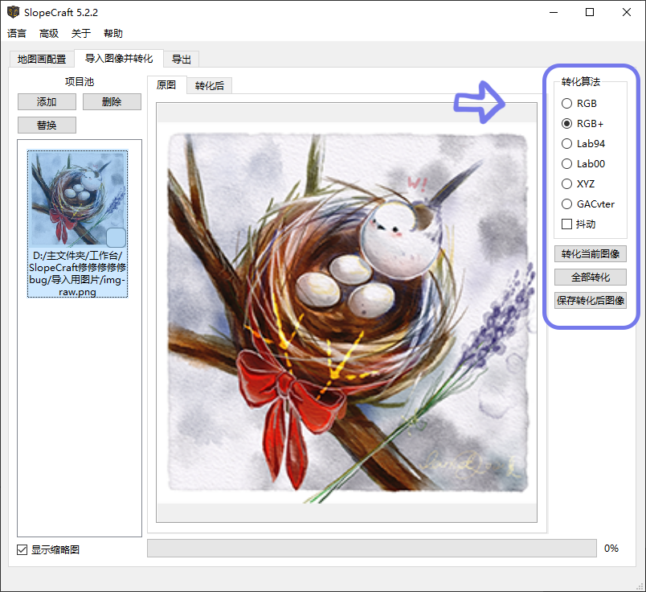

#### Choosing a conversion algorithm

The **Convert current image** button adjusts the colors of the image to colors available in the palette of the map art, while **Original** and **Converted** above the preview box show the original image and the adjusted map art respectively, so you can compare them.

There are 5 conversion algorithms above, **representing 5 ways of adjusting colors**. **Dither** uses the Floyd-Steinberg algorithm, trying to mix several similar colors to fit the original image better.

The first five conversion algorithms correspond to five different color difference formulas. Among the algorithms, RGB+ is the most recommended, RGB and XYZ are the fastest, and Lab94 and Lab00 give better results but are slower.

For the same image, these 5 kinds of adjustment all give different results.

We all want the map art to be as close to the original as possible, so you can try each kind of adjustment in turn, comparing back and forth with the two buttons, and choose the one that works best.

|  |  |
| :-------------------------------------------------------------------------: | :-------------------------------------------------------------------------------: |
|                              Before conversion                              |                                 After conversion                                  |

Adjusting the image may be slow, especially for large images. **If the progress bar suddenly stalls, or even the window stops responding, please do not close the window: do nothing and just wait patiently.** Adjusting the image involves a lot of computation; the lag is normal.

#### Convert all images (a special batch operation)

When you have chosen the algorithm you like best, click **Convert all** to convert every project in the project pool. Converted projects should have a ✔ at their lower right corner.

______________________________________________________________________________________________________________

Once all images are converted **(make sure every project has a ✔ at its lower right corner)**, it is time for the last step of generating map arts: **export**.

## Step 3. Export

There are 6 export types. The table below records how the map art types relate to the export types.

| Export type | 3D map art | Flat map art | File-only map art |
| :------------------------------: | :--------: | :--------: | :----------: |
| Litematica schematic (\*.litematic) | ✔ | ✔ | |
| Vanilla structure block file (\*.nbt) | ✔ | ✔ | |
| WE schematic (\*.schem) | ✔ | ✔ | |
| Map data file (\*.dat) | ✔ | ✔ | ✔ |
| Converted image (\*.png \*.jpg) | ✔ | ✔ | ✔ |
| Flat diagram (\*.png \*.jpg) | | ✔ | |

**Note: WE schematics (\*.schem) are only supported in 1.13+. In 1.12, WE uses the old schematic format with the \*.schematic suffix, which SlopeCraft does not support at the moment.**

On the export page, choose the type you need and configure it accordingly.

Since [the first four export types](#3a-export-as-litematica-schematic-vanilla-structure-block-file-we-schematic-flat-diagram "jump to the corresponding section") involve 3D structures, their settings differ considerably from [the map data file type](#3b-export-as-map-data-files "jump to the corresponding section"), so both are introduced below.
(Click a type name to jump there.)

### 3.a Export as Litematica schematic / vanilla structure block file / WE schematic / flat diagram

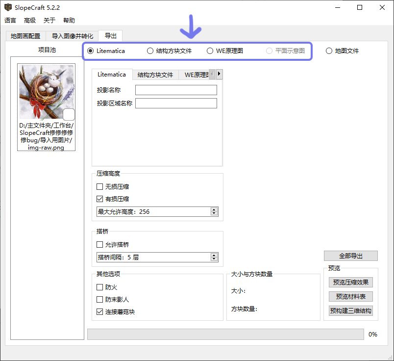

#### Compressing the height (has no effect on flat map arts)

SlopeCraft supports two compression methods: lossy and lossless.

Simply put, lossless compression compresses the total height of the map art under the premise of **strictly keeping the color of every pixel unchanged**, at the cost of continuity, but its constraints are strong and it may not work out as you wish. It is no exaggeration to say that some images are incompressible, such as a pure white part. That is when a new compression technique is needed: intelligent lossy compression.

Lossy compression then **slightly adjusts the colors of individual pixels** to compress the total height of the map art so that it is less than or equal to the maximum allowed height specified by the user. Lossy compression is implemented with a genetic algorithm, which belongs to population artificial intelligence and is the most technically advanced module in SlopeCraft at the moment. Do not set the maximum allowed height below 14, otherwise a 3D map art is very likely to fail to compress.

Generally speaking, the smaller the maximum allowed height of lossy compression, the more obvious the loss of image quality. Below, this image would be 255 blocks tall as a 3D map art, and is now lossily compressed (with lossless compression enabled as well). Figure 1 is the build result with a maximum height of 100 blocks, and figure 2 with a maximum height of 20 blocks.

|  |  |
| :------------------------------------------------------------------------------------------: | :----------------------------------------------------------------------------------------: |
| Figure 1 | Figure 2 |

There is no significant change before and after compression and the damage to image quality is not obvious. But on close inspection you can still see some gray dots in the white margins on both sides, and figure 2 has more gray dots than figure 1 because it is compressed more. In addition, a genetic algorithm is a stochastic optimization algorithm, so the modified pixels have a certain randomness and form no obvious regular pattern.

Lossy and lossless compression can be used together or separately. But generally speaking, if lossy compression is enabled, there is no reason not to enable lossless compression. Pure lossy compression needs to modify more pixels, which damages image quality more, while lossless compression can finish the compression with fewer modified pixels, largely reducing the damage.

You can check these two options for flat map arts, but they **will not play any role**.

#### Bridging

Every horizontal slice of a 3D map art contains many scattered blocks, which are extremely inconvenient to build. If multiple pathways could connect these scattered blocks, building would undoubtedly become much easier. Bridging is the process of connecting all blocks within a horizontal plane with glass blocks to form pathways, which helps the player build.

Undoubtedly bridging consumes extra glass, so it is not recommended to bridge every single layer of a 3D map art. By default a bridge is built every 4 layers, and you can change this interval. Too large an interval weakens the help of the bridges; too small an interval wastes glass.

For more details on map art compression and bridging, read [Principles of map arts](./principles-introduction.md).

[AbrasiveBoar902](https://github.com/AbrasiveBoar902) provided great help in optimizing the performance of bridging; thanks to him.

#### Other options

- **Fire-proof / enderman-proof:** as the name suggests, this protects flammable blocks and keeps endermen from stealing things. The method is to wrap every exposed face of these blocks with glass; I tested it and it works. But it also consumes a lot of glass, so choose carefully.

- **Connect mushroom blocks:** a map art generated by SlopeCraft may contain several adjacent mushroom blocks (including red mushroom block, brown mushroom block and mushroom stem), whose touching faces should be pore faces but are not in the generated schematic. This feature searches for all adjacent mushroom blocks and fixes their touching faces into pore faces.

#### Extra export options

The first four export types each accept extra export options and attach extra metadata; each is introduced below.

- **Options of Litematica schematics**

    In the **schematic name** and **schematic area name** fields you can fill in information about the schematic file. It is not mandatory.

    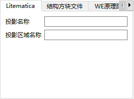

- **Options of vanilla structure block files**

    Vanilla structure block files are stored as a sparse matrix: wherever nothing is stored there is a structure void. This storage makes structure block files the most vanilla-compatible but worst-compressing format.

    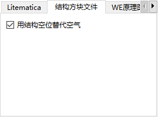

    Therefore structure block files have two choices for storing air blocks: as structure void, or stored as-is. Storing air as structure void saves a lot of space, but when pasted out in a structure block it cannot overwrite other non-air blocks; storing it as air blocks overcomes this problem, but the file size becomes very large.

- **Options of WE schematics**

    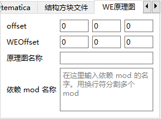

    WE schematics have a few more properties. They come from reverse engineering the schematics generated by WorldEdit and correspond directly to nbt tags of the same name. I do not know how these meta properties affect the schematic, because I hardly ever use WE.

- **Exporting flat diagrams**

    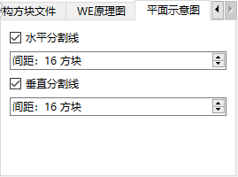

    Sets whether the exported diagram contains split lines, and the interval of the split lines.

#### Pre-building the 3D structure for preview (optional)

Click **Pre-build 3D structure** and SlopeCraft will build the map art into a 3D structure with the current settings, then show the size and total block count of the schematic.

**The pre-built 3D structure is only used for preview, not for exporting.**

**Note: if the y size of the schematic exceeds 256 / 384[^height], then by all means do not continue exporting. A schematic that exceeds the height limit is meaningless!**

[^height]: The build height differs between versions and dimensions. See the [Wiki](https://zh.minecraft.wiki/w/%E9%AB%98%E5%BA%A6) for details.

After pre-building the 3D structure, you can do the following two detailed previews:

- Preview the compression result: lossy compression may further change the image, and here you can check the state of the image.
- Preview the material list: preview the quantity of materials.

| 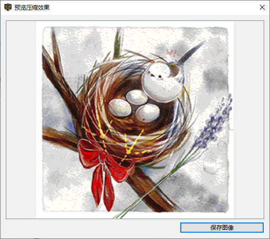 | 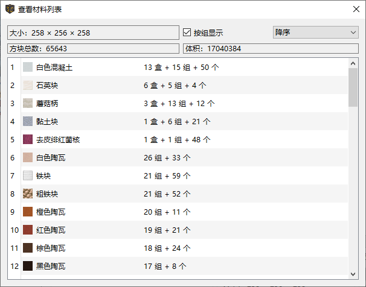 |
| :------------------------------------------------------------------------------------------------: | :----------------------------------------------------------------------------------------------: |
| Preview map art | Preview material list |

#### Export all

Once the settings are confirmed, click **Export all** and choose the **folder** to export all files into (an empty folder is recommended for batch operations).

______________________________________________________________________________________________________________

### 3.b Export as map (data) files

Click the **Map data file** option to jump to the corresponding page.

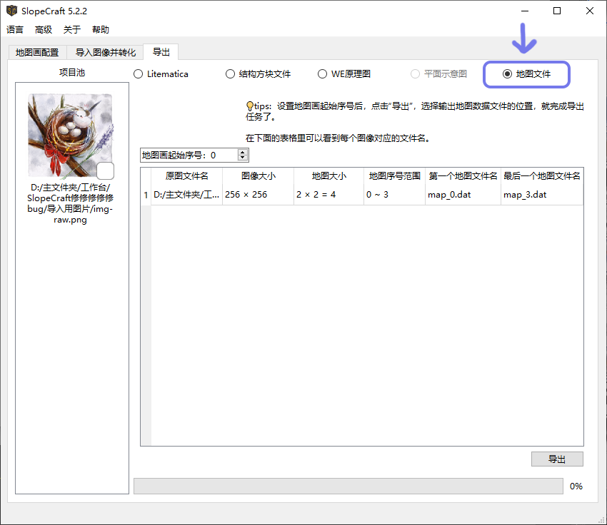

This page shows the number of rows and columns of the maps corresponding to the map art, the number of files, and the file names of the map data files to be exported.

#### Setting the initial number of the map data files

A map data file is named like map_i.dat, where i is an integer greater than or equal to 0, such as map_3.dat. **i is the number of this map data file. The number is in fact the unique identifier of the map data file.** Normally the map data files we generate should not overwrite unrelated map data files, so setting the initial number needs extra care.

Pressing <kbd>F3</kbd> + <kbd>H</kbd> in the game shows item details, **including the id of the map item, that is, the number of the corresponding map data file**. The map item shown below corresponds to a map data file named map_6.dat.

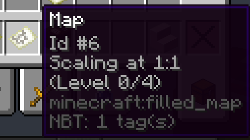

There are the following two ways to obtain the maps; pick whichever you like. The way you import them into the game afterwards also differs, so pay attention!

- If you want to obtain the maps with the /give command:

    The initial number can be anything, as long as it does not overwrite unrelated maps.

- If you do not want to use commands and only replace the map data files:

    **1.** First create the `n` maps corresponding to the map art, where n is the number of map data files shown by SlopeCraft — 4 in this example.

    **2.** Press <kbd>F3</kbd> + <kbd>H</kbd> in the game and check the numbers of the corresponding map data files. These maps should have the numbers `a`~`(a+n-1)`, n in total.

    **3.** Exit the world and fill the value of `a` into the **initial number of map data files** field in SlopeCraft.

Once the settings are confirmed, click **Export** and choose the **folder** to export all files into (an empty folder is recommended).

______________________________________________________________________________________________________________

## Step 4. Import the map art into the game

Jump to: | [Import Litematica schematics](#importing-litematica-schematics "jump to the corresponding section") | [Import structure block files](#importing-structure-block-files "jump to the corresponding section") | [Import WE schematics](#importing-we-schematics "jump to the corresponding section") | [Import map data files](#importing-map-data-files "jump to the corresponding section") |

### Importing Litematica schematics

Open the folder you just exported into and move the exported schematic to the .minecraft[^mcdir]/schematic folder. Then open Minecraft, enter your save/server, and import this schematic where you want to create the map art.

When placing the schematic, note that **the x and z coordinates of the schematic origin must be `-65+k×128`, where k is any integer**. The y coordinate can be anything. For example, (63,62,-65). Only then can **the map art be aligned with the grid of the map**.

Then start building this schematic, or just paste it. When finished, create new maps in the map interior. Each map should be unscaled, because each pixel corresponds to one block. Arrange them in order in item frames, and you are done.

- If it is a 2×2 map art, you should create 2×2, that is 4, maps.
- If your game version is 1.14 or later, it is best to lock the maps with glass panes in a cartography table.

### Importing structure block files

The directory for structure blocks is .minecraft[^mcdir]/saves/<save name>/generated/minecraft/structures

If you cannot find this directory, the game has not created it yet; you can create it manually and copy the files into it.

When loading the structure later, note that **the x and z coordinates of the structure origin must be `-65+k×128`, where k is any integer**. The y coordinate can be anything. For example, (63,62,-65). Only then can **the map art be aligned with the grid of the map**.

Using structure blocks is rather complicated, so it is not covered here; see [this bilibili tutorial](https://www.bilibili.com/video/BV1ro4y1m7xv).

### Importing WE schematics

The directory for WorldEdit schematics is .minecraft[^mcdir]/config/worldedit/schematics

If the directory does not exist, the game has not created it yet; you can create it manually and copy the files into it.

Afterwards, in the game you can import the schematic with the `//schem load <schematic name>` command. See WorldEdit tutorials for details, for example [this one](https://www.mcmod.cn/post/3050.html).

### Importing map data files

Open the folder you just exported into and move the exported map data files to the .minecraft[^mcdir]/saves/<save name>/data folder.

A "replace or skip files" window may pop up. If you are worried about overwriting unrelated maps, you can leave it for now and read on.

- Obtaining the maps with the /give command:

    This way **should not** trigger the "replace or skip files" window. If it does, close the window and check whether the map numbers conflict.

    - In 1.12, use `/give @s filled_map 1 i` to get the map with number i.
    - In 1.13+, use `/give @s filled_map{map:i}` to get the map with number i.

- Not using commands, only replacing the map data files:

    **1.** When you moved the files just now, the "replace or skip files" window **should** have popped up; click "Replace the files in the destination" to replace the files.

    **2.** Open the game; these `n` maps should have been successfully replaced with the map art.

[^mcdir]: Save data and configs are not necessarily stored directly in the .minecraft folder; the actual paths depend on version isolation. Take the `saves` folder as an example: if version isolation is off, the saves directory is `.minecraft/saves`, otherwise it is `.minecraft/versions/<your game version>/saves`.

## 🛠 Advanced features

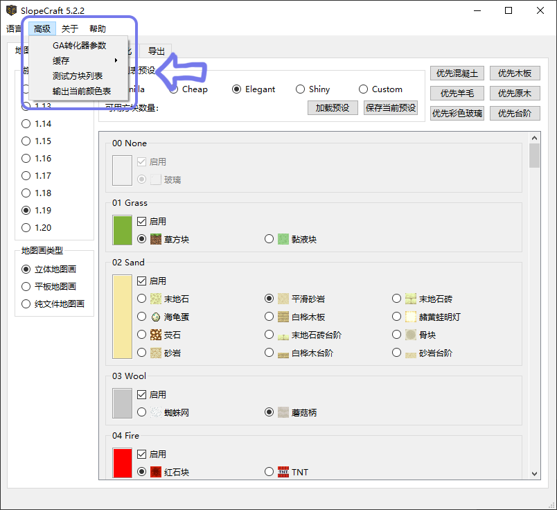

Some advanced operations can be found in the "Advanced" menu. Each is introduced below.

### Testing the block list

Missing blocks in a schematic are almost always caused by **mis-spelled ids**. If you import many blocks at once, this feature quickly tests every block in the block list for id errors.

Testing the block list generates a special structure block file containing every available block of every base color (except those that do not match the version). In the structure file every block is arranged in the order of the block list.

If everything is fine, no block will be missing; otherwise the corresponding block has an id error.

The figures below show the effect. Because the schematic is long, it is split into two screenshots.

| 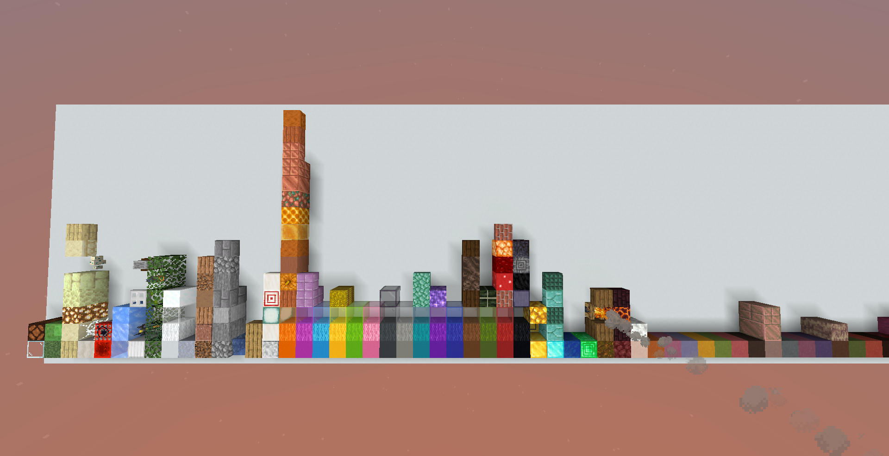 | 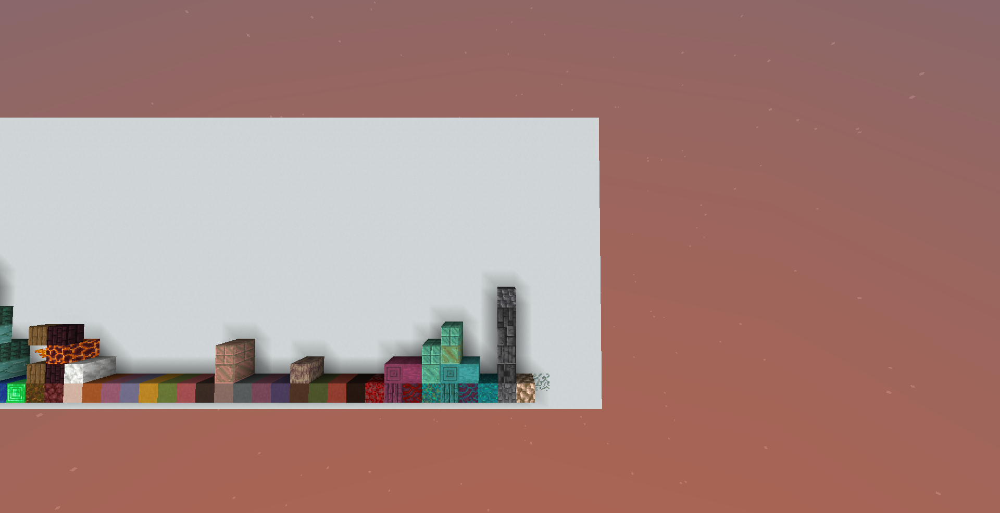 |
| :--------------------------------------------------------------------------------------: | :----------------------------------------------------------------------------------------: |
| Left half | Right half |

### Outputting the current color table

This menu item lets the user output the current color table as a $16\times 16$ png image containing all colors currently available.

| 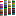 |  |  |
| :------------------------------------------------------------------------------------------: | :----------------------------------------------------------------------------------------------: | :------------------------------------------------------------------------------------------------------: |
| 1.19 3D | 1.19 flat | 1.19 file-only |

??? question "What is it for?"
    Outputting the color table is in effect exporting a "palette", which makes pixel art creation easier.

    If you want to draw by yourself and use the result in the game, follow the steps below to avoid unexpected errors:

    1. First finish the settings on the "map art configuration" page, so that you can output the color table you want
    2. Export the color table in the advanced menu
    3. Import the color table into your image editing software, draw, and export the image
    4. Do the "map art configuration" settings again (if you closed the software), and import the image
    5. When converting the image, choose the RGB+ algorithm and do **not** check dither
    6. The remaining export steps are the same as the normal flow; see [above](#step-3-export)

______________________________________________________________________________________________________________

## 🛠 Custom block lists

If you are not satisfied with the presets I provided and want to add other vanilla blocks or even mod blocks yourself, this chapter tells you how to add and use custom blocks in SlopeCraft.

### Preliminary information

You need to know the following information about a block:

1. The **complete** id of the block, including the **namespace prefix** and **all block properties**.

      For example, the upper slab of a waxed copper block:

      ```file
      minecraft:waxed_copper_slab[type=top,waterlogged=false]
      ```

      Here `minecraft:` is the namespace prefix of the vanilla block, and the content in the square brackets is all block properties. To be safe, you should set a corresponding value for every block property.

2. The earliest game version in which the block appears

      SlopeCraft uses the following values in block lists to refer to major versions:

      | Value | Version |
      | :-------: | :-------: |
      | "ANCIENT" | Earlier than 1.12 |
      | "MC12" | 1.12 |
      | "MC13" | 1.13 |
      | "MC14" | 1.14 |
      | "MC15" | 1.15 |
      | "MC16" | 1.16 |
      | "MC17" | 1.17 |
      | "MC18" | 1.18 |
      | "MC19" | 1.19 |
      | "MC20" | 1.20 |
      | "MC21" | 1.21 |
      | "MC26_1" | 26.1 |
      | "MC26_2" | 26.2 |
      | "MC26_3" | 26.3 |
      | 65535 | Future versions |

      Normally you should not use 65535, it is only a reserved value. If you insist on assigning a block to a future version, then everything that results is undefined behavior — I do not know what will happen either.

3. The id of the block in 1.12

      This property was added because Mojang changed quite a few block ids when updating from 1.12 to 1.13. If the block you want to add did not exist in 1.12, or its id did not change, you can fill in an empty string.

4. The base color of the block

      This is probably the easiest place to make mistakes. For vanilla blocks you can look it up on the [Minecraft Wiki](https://zh.minecraft.wiki/w/%E5%9C%B0%E5%9B%BE%E7%89%A9%E5%93%81%E6%A0%BC%E5%BC%8F#%E5%9F%BA%E8%89%B2). If it is a block added by a mod, either figure out how to measure it yourself, or ask the mod developer.

      If you do not know what a base color is, read [Principles of map arts](./principles-introduction.md)

5. The Chinese name of the block
6. The English name of the block
7. Whether the block needs other blocks attached below it
8. Whether the block glows
9. Whether the block is flammable
10. Whether the block can be stolen by an enderman
11. The texture image of the block (a 16*16 pixel png image is recommended)

### Blocks and the block list

In SlopeCraft, block lists are stored in json format, and the related images are placed in the FixedBlocks and CustomBlocks folders.

Block lists come in two kinds: fixed block lists and custom block lists. The fixed block list is the most basic set of blocks I provide, stored in **FixedBlocks.json** (the corresponding images are in the **FixedBlocks** folder), making sure every base color has a corresponding block. Although the blocks in the block list are in fact determined only at program runtime, **you should not modify it**.

Custom block lists are stored in **CustomBlocks.json**, with the corresponding images in the **CustomBlocks** folder. This is the user-defined block list, which allows the user to edit it flexibly. I wrote some slab blocks in there as a reference.

Each block has the following properties:

| Property name | Type | Required | Default | Description |
| :--------------: | :----: | :------: | :------: | :---------------------------------- |
| baseColor | byte | yes | | The base color of the block on the map |
| id | string | yes | | Block id, including the namespace and detailed block states |
| version | byte | yes | | The earliest version in which the block appears. |
| nameZH | string | yes | | The Chinese name of the block |
| nameEN | string | yes | | The English name of the block |
| icon | string | yes | | The file name of the image of the block |
| idOld | string | no | empty string | The id of the block in 1.12 |
| needGlass | bool | no | false | Whether the bottom of the block must have other blocks |
| isGlowing | bool | no | false | Whether the block is glowing |
| endermanPickable | bool | no | false | Whether the block can be stolen by an enderman |
| burnable | bool | no | false | Whether the block can be burned |

**The property wallUseable has been removed, because wall map arts have been removed.**

In json format it looks like this:

```json
{
    "baseColor": 11,
    "id": "minecraft:cobblestone_slab[type=top,waterlogged=false]",
    "nameZH": "圆石台阶",
    "nameEN": "Cobblestone slab",
    "icon": "cobblestone_slab.png",
    "version": "ANCIENT",
    "idOld": "minecraft:stone_slab[half=top,variant=cobblestone]"
}
```

The json above shows the information of a cobblestone top slab, parsed as follows:

1. Its base color is 11, which is also the base color of cobblestone, stone bricks and stone.
2. Its block id is "minecraft:cobblestone\_slab[type=top,waterlogged=false]"; the block state in the square brackets says that it is a top slab and does not contain water;
3. Its Chinese name is "圆石台阶" and its English name is "Cobblestone slab";
4. Its image is a file named "cobblestone_slab.png", placed in the CustomBlocks folder;
5. Its earliest version is 0, which means it was added before 1.12;
6. Because its block id changed in 1.13, its block id in 1.12 is the value of idOld.

<!-- https://cdn.jsdelivr.net/npm/sakana-widget@2.7.0/lib/sakana.min.css -->
<!-- https://cdn.jsdelivr.net/npm/sakana-widget@2.7.0/lib/sakana.min.js -->
<!-- https://cdnjs.cloudflare.com/ajax/libs/sakana-widget/2.7.0/sakana.min.css -->
<!-- https://cdnjs.cloudflare.com/ajax/libs/sakana-widget/2.7.0/sakana.min.js -->

<link
  rel="stylesheet"
  href="https://cdn.jsdelivr.net/npm/sakana-widget@2.7.0/lib/sakana.min.css"
/>
<div id="sakana-widget"></div>
<script>
  function initSakanaWidget() {
    new SakanaWidget().mount('#sakana-widget');
  }
</script>
<script
  async
  onload="initSakanaWidget()"
  src="https://cdn.jsdelivr.net/npm/sakana-widget@2.7.0/lib/sakana.min.js"
></script>

*You have found the end of the world (=・ω・=). Here is a cluster amaryllis as a reward.*
