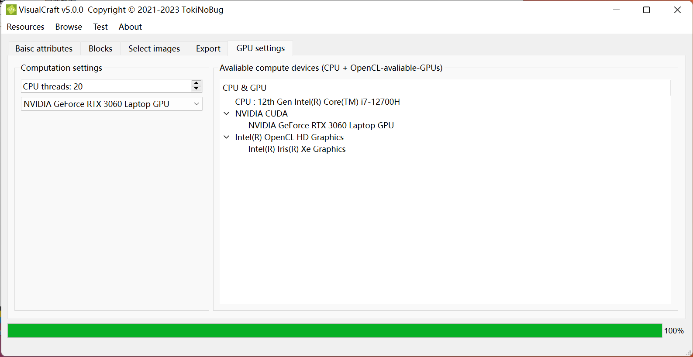
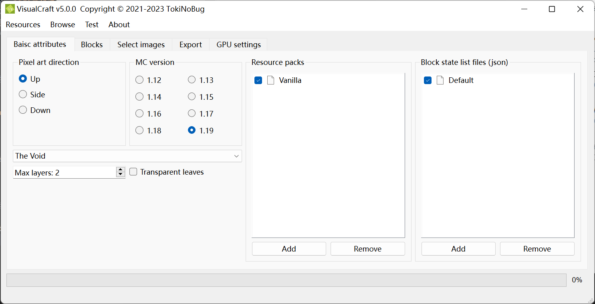
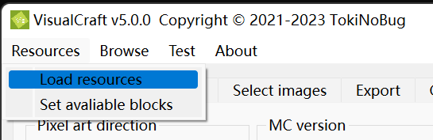
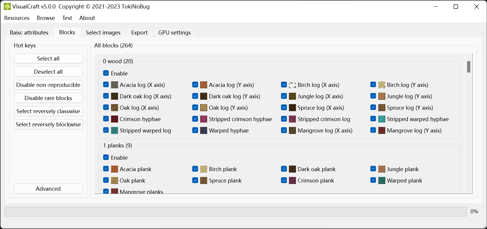
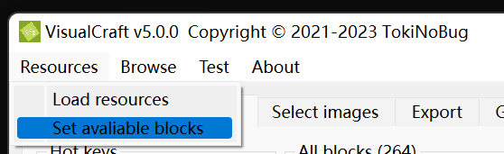
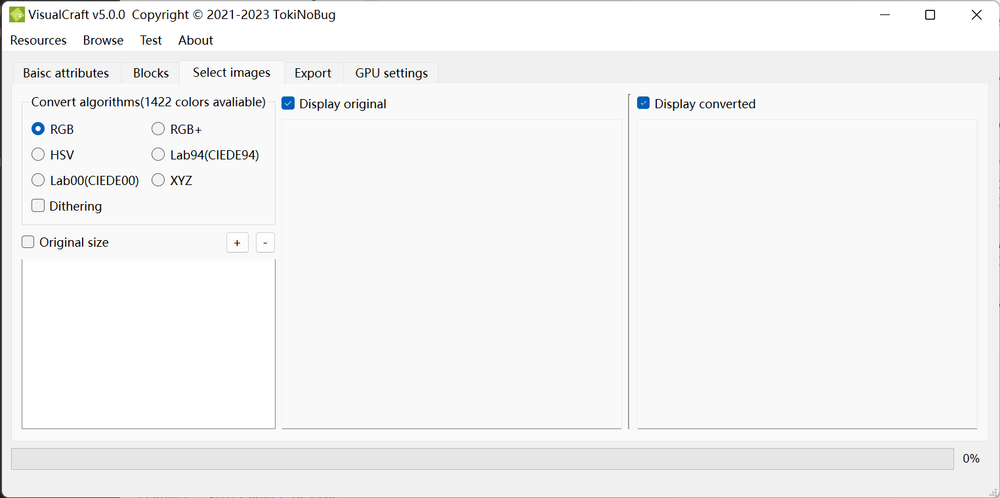
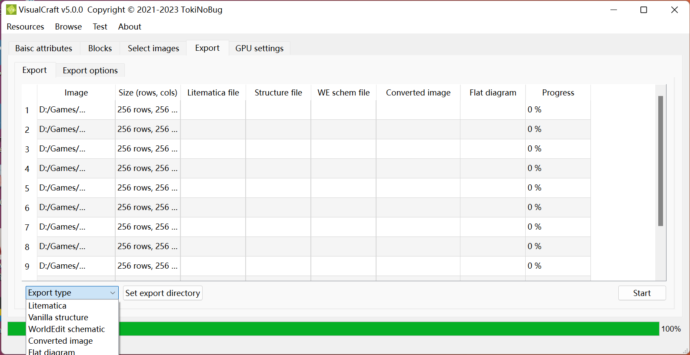
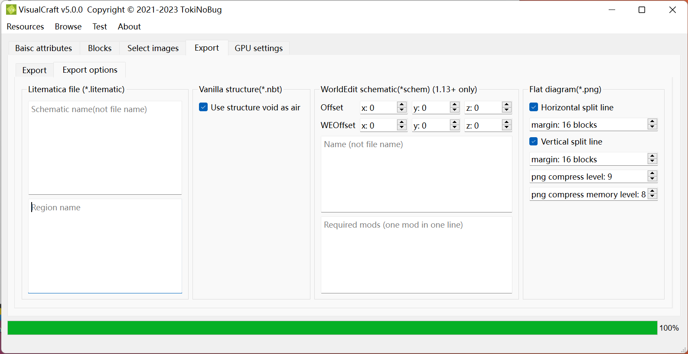

# VisualCraft Tutorial

## Introduction

VisualCraft is a brand-new Minecraft pixel art generator developed by the MC player TokiNoBug, and it is a subproject of SlopeCraft. Unlike other similar software, VisualCraft aims to keep up with the latest MC versions (1.12 ~ the latest), support as many MC features as possible, and provide the most powerful functions.

At the moment VisualCraft can parse many third-party resource packs, and also allows adding custom blocks. Different from the traditional approach, VisualCraft parses resource packs in terms of block models, staying as close to what Minecraft does as possible, so all kinds of custom block models are supported.

As for export, VisualCraft supports Litematica mod schematics (**\*.litematic**), WorldEdit schematics (**\*.shem**)(1.13+ only), vanilla structure block files (**\*.nbt**), flat diagrams (**\*.png**) and so on.

VisualCraft supports stacking various transparent blocks on top of each other to produce more colors. The software supports at most 65534 colors; limited by this, the number of layers of a pixel art does not exceed 3.

Because the number of colors is so large, VisualCraft uses GPU acceleration. The supported API is currently Vulkan, but it can also compute on CPU only.

## Step 0. GPU settings

This step is not compulsory. You can skip it, but if your image is very large, or you want to generate a pixel art of 3 layers, this step greatly improves the efficiency of VisualCraft.



Up to now there are two compute options: the number of CPU threads and the compute device.

In the first box you can set the number of CPU threads. The default value is the logical thread count of your CPU, coming from the return value of `std::thread::hardware_concurrency()`. You can set it a bit larger so that the CPU cores are used better, but too many threads add extra burden to the thread scheduler, which costs more time and consumes more power.

In the next radio box you can choose a compute device. This device is only used during image conversion, and all available devices are listed in the small tree widget on the right. Only Vulkan is supported as an API for now. For macOS, which has no official Vulkan support, I am trying various community solutions.

If VisualCraft was built without a GPU API, then only CPU computation is available and GPU acceleration cannot be used.

## Step 1. Basic attributes



On the first page you can set the basic attributes. On the left you can set the pixel art direction and the Minecraft version, while **biome**, **max layers** and **transparent leaves** can be set below.

The pixel art direction and the MC version are self-evident, while the last three options need to be explained.

1. **Max layers** refers to the maximum number of block layers of the pixel art, because VisualCraft supports stacking transparent blocks on non-transparent blocks.
    - Max layers should be a positive number and no greater than 3, otherwise the number of colors will exceed 65535, which is beyond the range of `uint16_t`.
2. **Biome** refers to the biome of the place where the pixel art is built.
    - In Minecraft, the colors of grass, leaves and vines depend on the biome, so it is necessary to input the biome.
3. **Transparent leaves** refers to whether leaves are treated as transparent blocks.
    - The appearance of leaves depends on the render options. If the graphics quality is not low, leaves are transparent blocks; otherwise they are opaque, and the transparent pixels in their texture are replaced with black (`0x000000`).

Resource packs and block state lists (BSL) can be set on the right. A resource pack is a zip that can be given to Minecraft, and a BSL is a json file that stores block information. Only blocks recorded in a BSL can be used by VisualCraft.

Resource packs and BSLs are shown in two lists. Click **Add** and you can select a file and add it to the list. To remove one or more items from the list, select them and click **Remove**. Note that only the selected items can be removed. You can sort the items by dragging them. If you want to use an item, check its checkbox, otherwise leave it unchecked. When several resource packs are parsed, they stack in the order of the list, just as Minecraft does. Several BSLs stack in the same way as resource packs.

**Vanilla resource pack** and **vanilla json** are special items that cannot be removed, because they represent the base resource pack and the base BSL respectively. But you can still disable them by unchecking their checkboxes.



If you have finished setting the basic attributes, click **Load resources** in the **Resource** menu and VisualCraft will load these resources.

## Step 2. Set the allowed blocks



After loading resources, all available blocks appear on the second page, separated by category. You can select or deselect any single block and any category.

### Hot keys

The hot keys on the left make selecting or disabling blocks more convenient. To eliminate ambiguity, note that: **in the following text, "select" and "enable" mean the same thing, and "disable" and "uncheck" also mean the same thing.**

|          Key name          | Effect                                                                                                |
| :------------------------: | :---------------------------------------------------------------------------------------------------- |
|         Select all         | Select all blocks                                                                                     |
|        Deselect all        | Deselect all blocks                                                                                   |
|  Disable non-reproducible  | Disable all non-reproducible blocks                                                                   |
|    Disable rare blocks     | Disable all rare blocks                                                                               |
| Select reversely classwise | Reverse the selection of each category, without affecting the checkboxes of blocks                    |
| Select reversely blockwise | Reverse the selection of all blocks, without affecting the checkboxes of categories                   |
|     Advanced matching      | Pops up a subwindow that lets you match blocks by custom rules and set them as selected or unselected |



After finishing the settings above, find the **Resource** menu and click **Set allowed blocks** to set the allowed blocks.

## Step 3. Load images



In fact, from a minimalist point of view, all you need to do is add images and then go to the next page. In this section I will introduce the widgets of this page.

After you set the allowed blocks, the number of colors is shown after **conversion algorithm**.

There are several algorithms that can convert images into pixel arts. VisualCraft and SlopeCraft use almost the same set of algorithms, so these options are the same. The only difference is that VisualCraft can be GPU accelerated, because it may have to handle more than 10 thousand colors and much larger images.

The logic of importing images is similar to that of importing resource packs and BSLs. Click **+** to add images and **-** to remove the selected images. VisualCraft was designed as a batch processing tool from the beginning, so all images are placed in one list. If you click an image, it is displayed and converted.

You can change the display options. Turn on **Display original size** to force all images to be displayed at their original size regardless of the label size. Select **Display original** and **Display converted** to decide whether to show the corresponding images.

## Step 4. Export



On this page you can tell VisualCraft how to export pixel arts and images. 5 export types are supported.

|         Type         | File name extension | Description                                                                 |
| :------------------: | :-----------------: | :-------------------------------------------------------------------------- |
|      Litematica      |    \*.litematic     | Litematica mod schematic                                                    |
| Structure block file |       \*.nbt        | Vanilla structure block file                                                |
|     WE schematic     |      \*.schem       | WorldEdit mod schematic (1.13+)                                             |
|   Converted image    |    \*.png \*.jpg    | The converted image                                                         |
|     Flat diagram     |       \*.png        | A flat diagram formed by replacing every pixel with the corresponding block |

Since VisualCraft is inherently a batch processing tool, you can select a type in the radio box and then click **Set export destination** to set the folder for the generated files. This operation fills the exported file names into the related columns.

If you want to change the way of exporting, just edit the export table. The third to the seventh columns are editable.

When you click **Start**, VisualCraft executes according to the table. If a cell is empty, it is skipped; otherwise the file name in that cell is parsed. If the extension is incorrect, an error may occur.

It is worth noting that a flat diagram may consist of several images, because a pixel art may have several layers. So the text in the cell is in fact a list of file names separated by semicolons "`;`" (**note: half-width characters!**). For example:

```bash
# Two layers
D:/image00_layer0.png;D:/image00_layer1.png
# Three layers
D:/image01_layer0.png;D:/image01_layer1.png;D:/image01_layer2.png
# One layer
D:/image01_layer0.png
```

If the number of semicolons is incorrect, an error will occur as well.

### Export options



On this page you can set the attributes of the exported files. The options of Litematica schematics, structure block files and WE schematics are the same as those in SlopeCraft, while the flat diagram options are worth explaining.

Since the flat diagram represents the whole pixel art with blocks, it is useful to draw horizontal and vertical lines to split the whole image into chunks. By default a split line is drawn every 16 blocks, which is the size of a Minecraft chunk. You can change the margin in the spin box, or check the checkbox to disable the split lines.

The flat diagram is generated by libpng, and it really is a large image, so you can tell libpng how to compress the image through **png compression level**. The ranges of the two level numbers are [0,9]. A larger compression level means better compression and more encoding time, while a larger memory level means more memory is used. **If you are not familiar with image and file compression, just keep the default values**.
